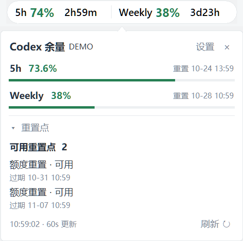
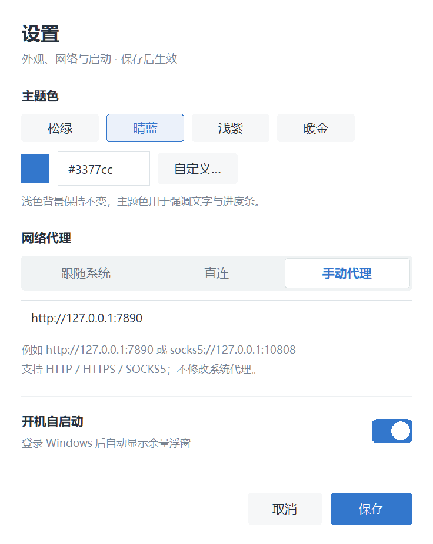

# Codex 余量浮窗

Windows 桌面额度小工具，显示 Codex 的剩余用量和重置倒计时。读取本机登录凭据直接查询，使用时不需要保持 Codex 运行。

## 功能

- 置顶胶囊显示 **5h / Weekly 剩余百分比和重置倒计时**，可拖动位置。
- 按账号实际提供的周期显示；没有 5h 额度时仅显示 Weekly，胶囊自动收窄。
- 鼠标悬停展开详情，查看进度、重置时间、套餐和重置点。
- 每 60 秒自动刷新，也可手动刷新。
- 支持自定义主题色、网络代理和开机自启动。
- 支持隐藏到系统托盘，通过托盘菜单恢复或退出。

## 界面预览

常驻浮窗显示剩余额度和重置倒计时，截图使用示例数据。


| 悬停详情与重置点 | 主题、代理与开机自启动 |
| --- | --- |
|  |  |

## 使用

从 [Releases](https://github.com/JustLookAtNow/codex-usage/releases/latest) 下载 `CodexUsage.exe` 后直接运行，无需安装 Python。也可以按照下方说明从源码运行或自行打包。

需要本机存在通过 ChatGPT 账号登录的 Codex 凭据：

```text
%USERPROFILE%\.codex\auth.json
```

仅使用 API Key 的登录不支持订阅额度查询。程序读取 Windows 用户目录下的凭据，不读取 WSL 中的登录状态。

- **查看详情**：鼠标移到胶囊上展开，移开后自动收起。
- **查看重置点**：在详情中点击“重置点”展开数量、状态和过期时间；每次启动默认折叠。
- **打开设置**：点击详情中的“设置”，或使用胶囊右键菜单、托盘菜单。
- **隐藏与退出**：详情右上角 `×` 隐藏到托盘，双击托盘图标恢复；从右键菜单或托盘菜单退出程序。
- **取消置顶**：使用胶囊右键菜单或托盘菜单中的置顶选项。

时间按 Windows 本地时区显示。接口没有提供的数据会显示为“未提供”或 `—`。

## 设置

修改设置后点击“保存”生效，点击“取消”放弃修改。

### 主题色

可选择预设配色、输入 `#RRGGBB` 或使用颜色选择器。界面保持浅色背景，主题色用于百分比和进度条等强调内容；过浅的颜色会自动加深，保证文字可读。

### 网络代理

| 模式 | 行为 |
| --- | --- |
| 跟随系统 | 使用系统及 `HTTP_PROXY` / `HTTPS_PROXY` 环境变量中的代理，默认选项 |
| 直连 | 忽略系统及环境变量代理，直接连接 |
| 手动代理 | 使用填写的 HTTP、HTTPS 或 SOCKS5 地址，连接失败时不会绕过代理直连 |

手动代理需要包含协议和端口，例如 `http://127.0.0.1:7890` 或 `socks5://127.0.0.1:10808`。SOCKS5 地址保存后会显示为 `socks5h://`，表示由代理解析域名。代理设置不支持用户名密码、PAC 脚本或订阅链接。

保存代理后会重新查询。程序不会修改 Windows 系统代理设置。

### 开机自启动

默认关闭。打开开关并保存后，当前用户登录 Windows 时会自动显示余量浮窗；关闭并保存即可移除启动项。通常不需要管理员权限。

移动、重命名或更换程序文件后，请重新保存自启动设置，使启动项指向正在使用的程序。也可以在 Windows 的“启动应用”中管理它。

## 数据与隐私

凭据文件只读，不会复制、修改或自动续期。程序只查询额度，不会消耗重置点；没有遥测或默认日志。

窗口位置、主题色和代理配置保存在：

```text
%LOCALAPPDATA%\CodexUsage\settings.json
```

此文件不保存登录凭据或额度数据。

## 常见问题

- **连接超时或失败**：检查当前网络是否能访问 ChatGPT，或在设置中填写可用的代理地址。
- **登录凭据已失效**：更新本机 Codex 登录凭据，程序会在后续查询时重新读取。
- **访问受限（403）**：检查网络连接和账号权限。
- **请求受限（429）**：程序会遵守服务端的重试时间，手动刷新也不会提前发起请求。
- **数据已过期**：查询失败时保留最近一次成功数据，恢复连接后自动更新。

## 源码运行

使用 Windows 和 Python 3.14，在项目目录运行：

```powershell
python -m venv .venv
.venv\Scripts\python.exe -m pip install -r requirements.txt
.venv\Scripts\pythonw.exe main.py
```

仅查询一次并在终端输出结果：

```powershell
.venv\Scripts\python.exe main.py --check
```

用量查询成功返回退出码 `0`，失败返回 `1`。输出不包含凭据、请求头或原始接口响应。

## 测试与打包

```powershell
.venv\Scripts\python.exe -m pip install -r requirements-dev.txt
.venv\Scripts\python.exe -m unittest discover -v
powershell -ExecutionPolicy Bypass -File build.ps1
```

打包生成 `dist/CodexUsage.exe`，为无需控制台的单文件程序。打包前请退出正在运行的同名 EXE。

测试使用模拟凭据、接口响应和启动项，不读取实际账号或修改真实自启动设置。UI 测试会短暂显示窗口。

检查打包后的窗口、设置页和托盘功能：

```powershell
Start-Process .\dist\CodexUsage.exe -ArgumentList '--smoke-test', '.cache/packaged-smoke' -WindowStyle Hidden -Wait
Get-Content .cache/packaged-smoke/checks.json
```

检查使用示例数据，在指定目录保存结果和截图，完成后自动退出。

## 自动发布

推送 `v*` 版本 tag 后，GitHub Actions 会运行非 GUI 测试、构建 Windows x64 EXE，并创建对应的 Release。例如：

```bash
git tag -a v0.3.0 -m "Release v0.3.0"
git push origin v0.3.0
```

后续发布使用新的版本号。带 `-beta`、`-rc` 等后缀的 tag 会生成预发布版本。Release 包含 `CodexUsage.exe`、`SHA256SUMS.txt` 和自动生成的发布说明。

测试或打包失败时不会发布；附件上传失败后可重跑工作流，继续完成草稿。已公开的同名 Release 不会被重跑覆盖。

## 接口说明

程序通过 HTTPS 查询以下接口，保留证书验证并拒绝自动跳转：

- `GET https://chatgpt.com/backend-api/wham/usage`
- `GET https://chatgpt.com/backend-api/wham/rate-limit-reset-credits`

接口参考 [Codex 官方源码](https://github.com/openai/codex/blob/d6817454d76885e9d0e118bbf82e507aed6f715a/codex-rs/backend-client/src/client/rate_limit_resets.rs)。这些客户端后端接口可能发生变化，查询和解析逻辑位于 `codex_usage/core.py`。
